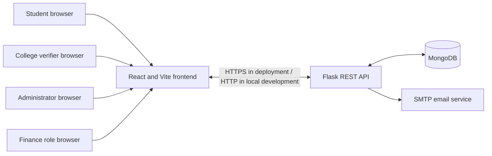
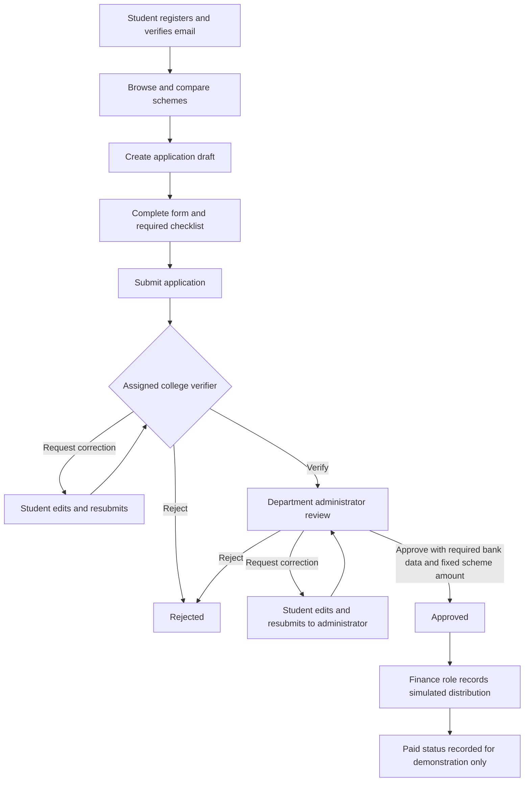
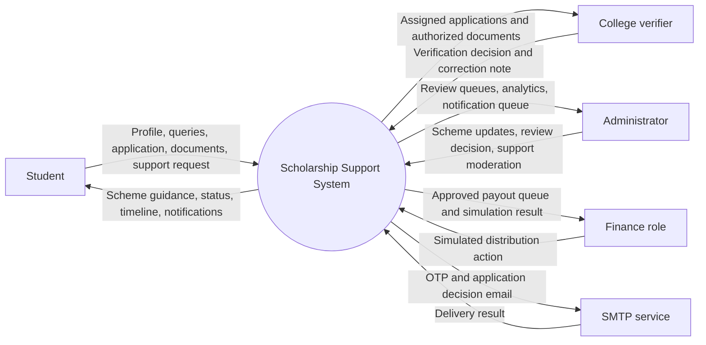
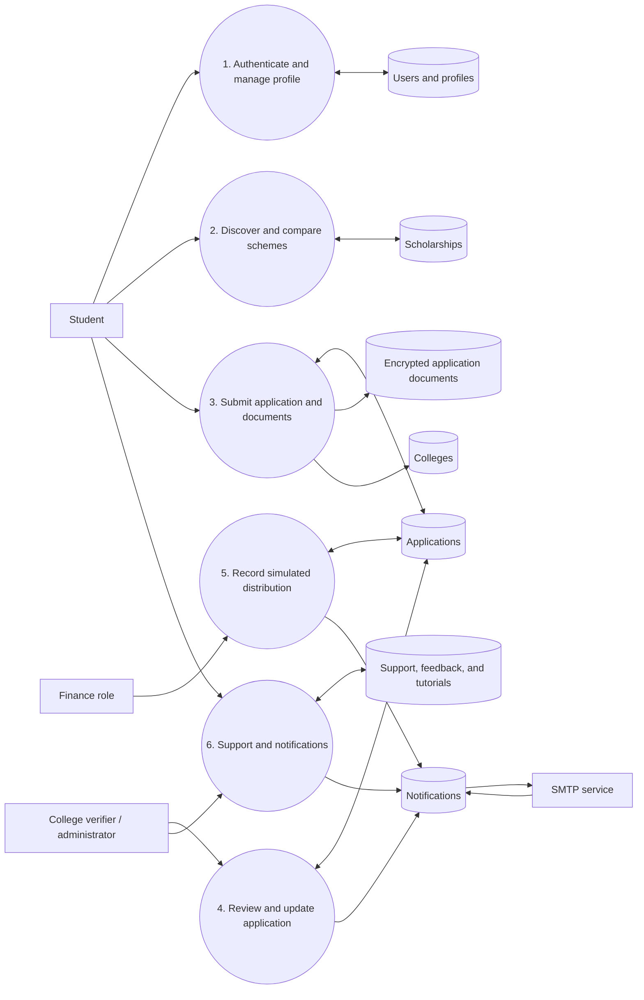
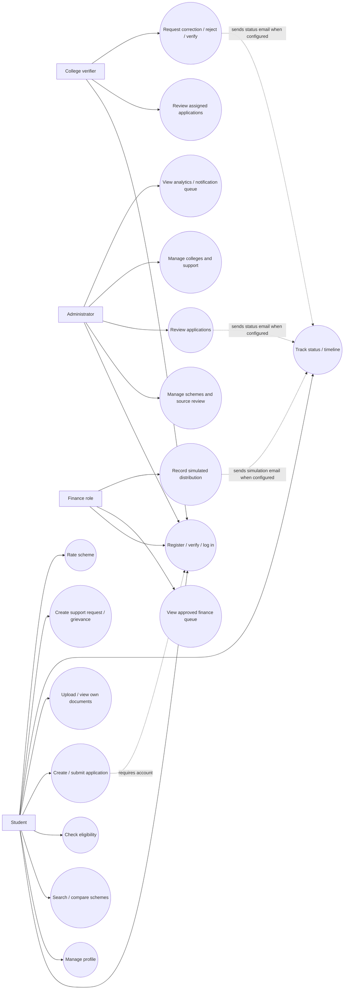
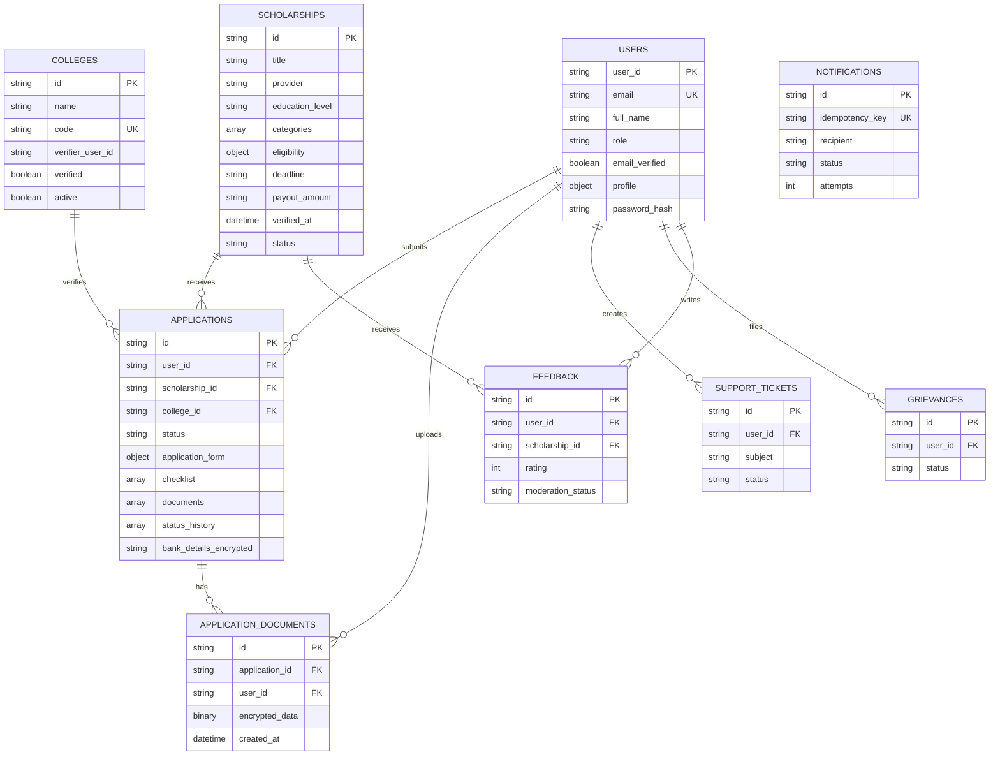

# Scholarship Support System

## Field Project Report

**Submitted by:** [Student name]  
**Class / Year:** Third Year [Course and branch]  
**Roll number:** [Roll number]  
**Institute:** [College / institute name]  
**Project guide:** [Guide name]  
**Academic year:** [Academic year]

> Replace bracketed details with your own information. The system described here is an academic prototype for scholarship discovery and internal application tracking. It is not an official MahaDBT service and does not transfer funds.

## Abstract

The Scholarship Support System is a web-based prototype designed to help students discover scholarship schemes and follow an application through an internal review workflow. It combines a searchable scholarship directory, student profiles, eligibility guidance, application and document tracking, college verification, administrator review, email notifications, and student support features in one application.

Students can create an account using email verification, maintain education and eligibility details, compare schemes, and prepare an application with supporting documents. A college verifier can review applications assigned to that college and verify, reject, or request corrections. The department administrator can review college-verified applications, request corrections, approve or reject them, and manage scholarship information. An authorized finance role can record a simulated distribution after approval. Any such distribution is only a demonstration record: the system does not connect to a bank or transfer money.

The frontend is built with React and Vite. A Flask REST API implements the application logic and MongoDB stores account, scheme, application, document, notification, and support records. Passwords and one-time codes are hashed; optional Aadhaar, submitted documents, and bank details use separate encryption keys. The project demonstrates a role-based, traceable workflow while requiring users to confirm official scheme rules and deadlines through authoritative sources.

**Keywords:** Scholarship portal, student support, eligibility guidance, application tracking, role-based access, Flask, React, MongoDB.

## 1. Introduction

Scholarship opportunities can be difficult for students to discover and compare. Application information may be spread across scheme pages, institutional offices, and document checklists. Students may also have limited visibility into whether an application is waiting for college verification, administrator review, correction, or a later finance step.

The Scholarship Support System provides a single prototype interface for scholarship discovery and internal progress tracking. It lets students maintain optional eligibility information, search and compare directory entries, and view an application timeline. College verifiers and administrators have separate review responsibilities. The system also provides a help centre, grievance tracking, ratings, tutorials, and a source-constrained scholarship assistant.

The portal is designed as a support and demonstration system. Its account verification and college-verifier provisioning are project workflows, not official institutional identity verification. Scheme information must be checked against official guidelines. Approval and simulated payment status in this portal do not constitute a government decision or proof of a real transfer.

### 1.1 Objectives

- Provide a searchable, maintainable scholarship directory.
- Help students compare scheme information and understand basic eligibility criteria.
- Track a student's application from draft through review, correction, decision, and simulated payment status.
- Give college verifiers and department administrators separate, role-appropriate review queues.
- Protect sensitive credentials, documents, and bank data using hashing, encryption, consent, and access checks.
- Notify students of relevant application decisions by email when SMTP is configured.
- Provide support requests, grievances, moderated feedback, tutorials, and multilingual guidance.

### 1.2 Scope and limitations

The prototype includes student, college-verifier, administrator, and finance workflows; a directory and deterministic assistant based on administrator-reviewed scheme records; and a simulation-only finance step. It does **not** submit applications to MahaDBT or another government portal, validate institutions with a government authority, make eligibility decisions on behalf of a scheme authority, or transfer funds.

## 2. Need of the System

The system addresses the following practical needs:

1. **Information organization:** Scheme title, provider, eligibility summary, categories, deadline, and document checklist are available in a common directory.
2. **Personalized discovery:** Optional student profile data supports eligibility guidance and recommendations when required fields are present.
3. **Application visibility:** A tracker and timeline show the current stage instead of leaving students uncertain after submission.
4. **Structured institutional review:** Applications assigned to a college can be reviewed by its verifier before administrator review.
5. **Correction handling:** A reviewer can request changes; the student can edit and resubmit while corrections are pending.
6. **Document handling:** Required checklist items and uploaded supporting documents are associated with the relevant application and restricted to authorized review.
7. **Communication and support:** Email notifications, tickets, grievances, feedback, and tutorials provide additional support channels.
8. **Data protection:** Passwords are stored as hashes; optional Aadhaar, uploaded documents, and bank data are encrypted separately. Role checks limit access to protected operations.

## 3. Proposed System

### 3.1 System architecture

The React single-page application communicates with a Flask REST API over HTTP using JSON and multipart requests for uploads. The API validates requests, authenticates the user, checks role permissions, applies workflow rules, and reads or writes MongoDB collections. Email notifications are sent through configured SMTP. Uploaded application documents are encrypted before storage; the standalone document-quality check processes its upload in memory.

### 3.2 Main modules

| Module | Main functions |
|---|---|
| Authentication and account management | Registration, email OTP verification, login, signed tokens, password reset, role-aware access |
| Student profile | Optional education and eligibility information, profile editing, profile completion |
| Scholarship directory | Search, filtering, sorting, scheme details, administrator creation and maintenance, source review |
| Eligibility and recommendations | Criteria-based eligibility result, missing-information guidance, profile-based recommendations, scheme comparison |
| Application management | Draft creation/resume, form submission, status tracking, reminders, timeline, correction/resubmission |
| Document management | Checklist, supported document upload, encrypted storage, authorized review download, standalone in-memory upload check |
| College verification | College/verifier provisioning, college-scoped queue, verify/reject/request-correction decisions |
| Administrator review | Review queue, correction request, final approval/rejection, scholarship amount configuration |
| Finance simulation | Finance-only queue and simulated distribution record; no bank transfer |
| Student support | Help tickets, grievances, rejection/payment guidance, moderated ratings, tutorials |
| Scholarship assistant | Deterministic matching against active, administrator-reviewed scheme records; English, Hindi, and Marathi responses where translations exist |
| Notifications and analytics | Email queue/retry visibility, application and support summaries, survey information |

### 3.3 Application workflow

Applications without a college assignment follow the relevant administrator workflow available to them. The portal's final “paid” state is explicitly a simulated record and does not mean funds were transferred.

### 3.4 Data-flow diagrams

#### DFD Level 0 — Context diagram

#### DFD Level 1 — Main processes and data stores

### 3.5 Use-case diagram

### 3.6 Entity-relationship diagram

The application uses MongoDB document collections. The following ERD shows logical references between records; it does not imply relational SQL foreign-key enforcement.

## 4. Software and Hardware Requirements

### 4.1 Software requirements

| Component | Requirement / technology |
|---|---|
| Operating system | Linux, Windows, or macOS capable of running Python and Node.js |
| Frontend | React 18, JavaScript/JSX, Vite 6 |
| Backend | Python 3.9+ recommended; Flask 3.1 REST API |
| Database | MongoDB server or MongoDB Atlas-compatible connection |
| Database driver | PyMongo 4 |
| Browser | Current Chrome, Firefox, Edge, or equivalent modern browser |
| Email | SMTP server/account for OTP and notification email |
| Frontend packages | React DOM, React Three Fiber/Drei, Chart.js, Lucide React |
| Backend packages | Flask, PyMongo, python-dotenv, cryptography, Pillow, email-validator |
| Development tools | Git, Python virtual environment, pip, Node.js/npm, code editor |
| Configuration | Environment variables for database, signing key, encryption keys, SMTP, and role allowlists |

The project manifest pins backend package versions in `backend/requirements.txt`; the frontend dependency versions are declared in `frontend/package.json` and `frontend/package-lock.json`. Python 3.9+ and the hardware values below are recommended project setup guidance, not a claim that the application enforces those minimums.

### 4.2 Hardware requirements

No specialized hardware is required for local academic demonstration.

| Use | Suggested minimum |
|---|---|
| Development/demo computer | Dual-core processor, 8 GB RAM, and 5 GB free disk space, excluding large dependency caches |
| Comfortable development | Quad-core processor, 8–16 GB RAM, and 10 GB free disk space |
| Student/admin device | Desktop or laptop with a modern browser; a phone can be used for responsive UI checks |
| Server/database | For a small demo, a modest VM or managed MongoDB service; size production resources based on users, storage, and retention needs |
| Network | Internet access for remote MongoDB/SMTP and email delivery; local frontend/backend can be demonstrated on localhost |

These are practical recommendations, not measured load-test results or production capacity guarantees.

## 5. Database Design

MongoDB stores JSON-like BSON documents in collections. Application records use generated string IDs and store references such as `user_id`, `scholarship_id`, and `college_id`. The API enforces access and workflow rules; MongoDB relationships shown above are logical references.

| Collection | Purpose and representative fields |
|---|---|
| `users` | Verified accounts, role, user ID, email, name, password hash, optional profile, and college link for verifier accounts |
| `pending_users` | Registration awaiting email verification, hashed OTP, attempt count, and expiry |
| `password_reset_requests` | Password-reset OTP hash, expiry, and verification-attempt data |
| `counters` | Atomic yearly student-ID sequence |
| `scholarships` | Scheme title/provider, education level, categories, eligibility object, deadline, checklist, optional official URL, fixed payout amount, active status, and administrator review metadata |
| `applications` | Student/scheme/college references, application form, workflow status, checklist, document metadata, status history, review notes, reminder, and encrypted bank details |
| `application_documents` | Encrypted file bytes linked to application and uploading student; metadata is also listed on the application record |
| `colleges` | College identity/code, active and prototype-verified flags, creator, and linked verifier ID |
| `notifications` | Email recipient and subject/body, status, attempt count, last error, timestamps, and idempotency key for retry handling |
| `support_tickets` | Student reference, subject, message, status, and timestamps |
| `grievances` | Student grievance, status, resolution details, and timestamps |
| `feedback` | Student/scheme reference, rating, comment, moderation status; unique student/scheme rating index |
| `tutorials` | Administrator-managed tutorial title, language, URL, status, and display order |
| `surveys` | Administrator-managed survey question, source, options/results, language, and publication status |

### 5.1 Data protection and access control

- Passwords and OTPs are stored as cryptographic hashes rather than plaintext.
- Optional Aadhaar, application documents, and bank details use separate Fernet encryption keys.
- Application documents and bank data are not returned in ordinary student, college, or administrator application responses. Access is scoped to the appropriate user/reviewer or finance workflow.
- Administrator and finance access use separate email allowlists; college verifiers are scoped to their assigned college.
- SMTP credentials, MongoDB connection strings, signing secrets, and encryption keys belong in protected environment configuration, not source control.
- Encryption keys must be backed up and kept stable; changing a key without a migration makes already encrypted values unreadable.

## 6. Project Screenshots for the Report

Use fresh screenshots from your own running project with realistic demo records. Hide student names, email addresses, student IDs, OTPs, bank details, credentials, browser saved passwords, and all `.env` values. Do not use the screenshot of `.env` as a report figure.

Suggested figures and locations:

| Figure | Screen to capture | Place in report |
|---|---|---|
| Figure 1 | Student login / registration page | Introduction or system overview |
| Figure 2 | Student dashboard with profile completion and application summary | Proposed system / student module |
| Figure 3 | Scholarship directory with search and filters | Scholarship discovery module |
| Figure 4 | Scholarship detail / eligibility result | Eligibility module |
| Figure 5 | Application form with checklist (use dummy data; hide sensitive fields) | Application workflow |
| Figure 6 | Student application tracker and timeline at a pending stage | Application workflow |
| Figure 7 | College verifier queue and an opened application summary | College verification module |
| Figure 8 | Administrator application queue with status filters | Administrator module |
| Figure 9 | Scholarship editor showing a demo fixed amount, or reviewed-scheme marker | Administration / finance prerequisite |
| Figure 10 | Finance simulation queue and simulation confirmation/result | Finance simulation module; caption explicitly says no real transfer |
| Figure 11 | Scholarship assistant response for an administrator-reviewed demo scheme | Assistant module |
| Figure 12 | Help/support or grievance page | Student support module |
| Figure 13 | Mobile/responsive view (optional) | User-interface evaluation |

For each image, add a numbered caption and one sentence describing the visible function, for example: **“Figure 6: Student application tracker showing the current review stage and application timeline.”** Use screenshots of functioning screens, not errors or secret configuration files.

## 7. Testing and Validation

The project includes backend workflow tests and frontend behavior/localization tests. At the time this report draft was prepared, the automated suite completed with **39 backend tests** and **18 frontend tests** passing; the frontend production build also completed. Re-run the tests on the final submission revision and update these counts if they change.

Suggested manual demonstration:

1. Register a demo student and complete email OTP verification.
2. Sign in, update the profile, browse and compare a scholarship.
3. Create an application draft, complete required fields/documents, and submit.
4. Sign in as the linked college verifier and verify or request a correction.
5. Sign in as the administrator and review the application.
6. Configure a fixed demo amount before approval; verify the student status and configured email notifications.
7. Sign in as the finance role and record a simulated distribution; explicitly demonstrate that it is not a real bank transfer.
8. Test support, grievance, feedback moderation, and the assistant using a reviewed scheme record.

Email delivery depends on valid SMTP configuration and network access. Automated tests mock notification delivery; passing tests do not prove that a real mailbox received an email.

## 8. Future Scope

- Integrate with official scholarship portals only through authorized APIs and documented agreements.
- Add verified data-import workflows for official scheme information, with source URLs and update dates.
- Add multilingual content review and accessibility/usability testing with students.
- Add a secure production deployment, monitoring, backups, audit retention, and a documented privacy/data-retention policy.
- Add operational retry scheduling and delivery reporting for failed notifications.
- Add stronger account protections such as multi-factor authentication and administrator audit views.
- Conduct security testing, load testing, and independent privacy review before real-world deployment.
- Integrate a real payment provider only if legally and operationally authorized; otherwise retain clearly labeled simulation-only behavior.
- Add additional roles or institution onboarding only with defined identity-verification procedures.

## 9. Conclusion

The Scholarship Support System demonstrates how scholarship information discovery and a multi-stage application-tracking workflow can be organized in a single web application. Students can explore schemes, receive eligibility guidance, submit and track applications, and contact support. College verifiers and administrators have distinct review responsibilities, while finance access is separated and the final distribution stage is explicitly simulated.

The project combines a React/Vite frontend, Flask API, MongoDB storage, SMTP notifications, role-based access checks, and encryption for selected sensitive data. It is suitable as an academic field-project prototype and demonstration. It is not an official MahaDBT integration, an authoritative eligibility decision service, or a payment system; those limitations should be stated clearly during the presentation.

## 10. References

1. Flask Documentation, Pallets Projects. <https://flask.palletsprojects.com/>
2. React Documentation. <https://react.dev/learn>
3. Vite Documentation. <https://vite.dev/guide/>
4. MongoDB Manual. <https://www.mongodb.com/docs/manual/>
5. PyMongo Documentation. <https://www.mongodb.com/docs/languages/python/pymongo-driver/current/>
6. Python Documentation. <https://docs.python.org/3/>
7. Python Cryptographic Authority, Fernet documentation. <https://cryptography.io/en/latest/fernet/>
8. Werkzeug Security Utilities documentation. <https://werkzeug.palletsprojects.com/en/stable/utils/#module-werkzeug.security>
9. MahaDBT, Government of Maharashtra official portal. <https://mahadbt.maharashtra.gov.in/> (for authoritative scheme information; this project is not integrated with that portal).
10. OWASP, Password Storage Cheat Sheet. <https://cheatsheetseries.owasp.org/cheatsheets/Password_Storage_Cheat_Sheet.html>

**Project-specific references:** `backend/README.md`, `backend/requirements.txt`, `frontend/package.json`, and the project source and automated tests.
